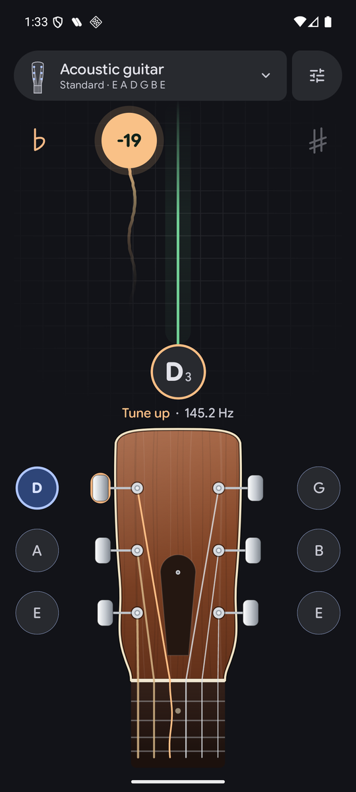
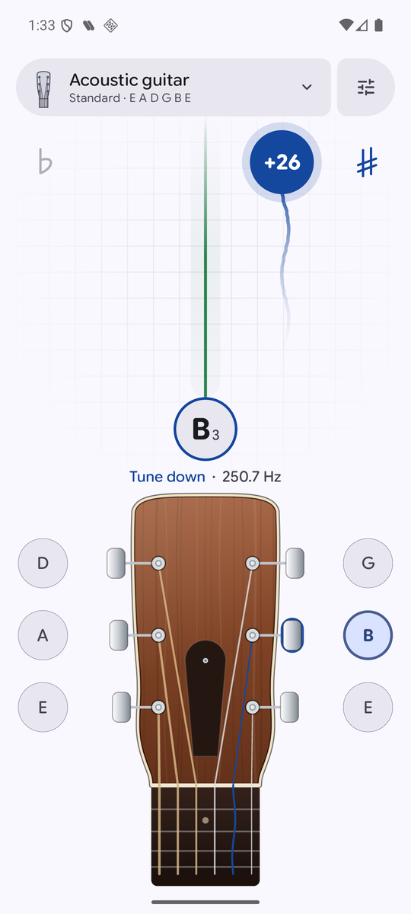
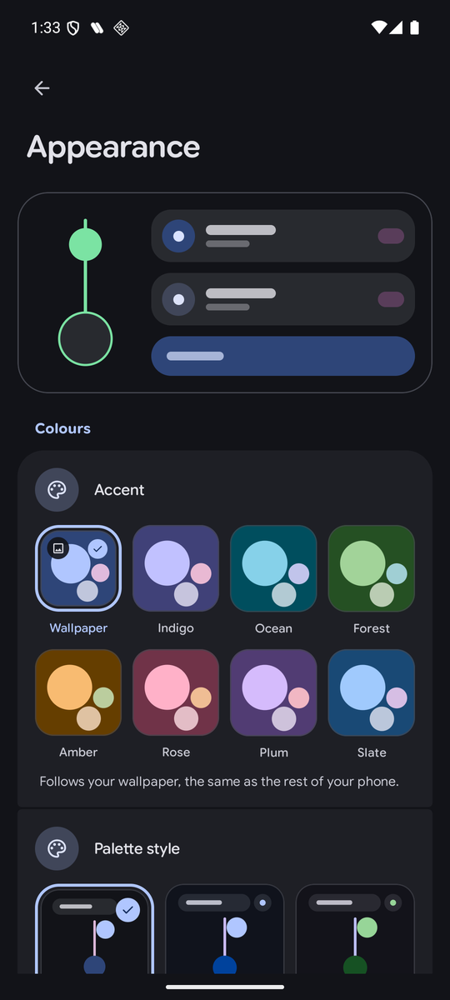

# GuitarTuner

[](https://github.com/Marukiee/GuitarTuner/releases/latest)
[](LICENSE)
[](#install)

English | [Nederlands](README.nl.md)

**An open source chromatic tuner for Android with a wooden guitar head.** It follows your wallpaper's
colours, tunes eleven instruments, and listens to your strings without sending anything anywhere.
No ads, no accounts. The only network call is one check of the GitHub releases to tell you when a new build is out.

## Screenshots

<p>
  
  
  
</p>

## What it does

- **A line and a bubble.** The bubble slides along the line with the pitch: left is flat, right is sharp, and a tick appears when the string is right. A trail behind it shows where the pitch just was
- **A wooden head for every instrument.** Eleven instruments, each with its own head and a bubble beside every tuner. Tap one to tune that string, tap it again to go back to auto, hold it to hear the note
- **Starts in auto.** Play a string and it finds which one. When every string is done, tap the note under the line to start over
- **Reference tones.** Tap the note to hear it and tune by ear
- **Your colours.** Material You colours from your wallpaper, light, dark or pure black, and English or Dutch
- **Private.** Audio never leaves the device

## Install

1. Download `guitartuner.apk` from the [latest release](https://github.com/Marukiee/GuitarTuner/releases/latest) on your phone.
2. Open it. Android asks once whether the app you open it with (your browser or files app) may install apps from unknown sources. Turn that on, go back and tap Install.

After that you never need GitHub again. The app tells you when a newer build exists and links straight to it. Every release is signed with the same key, so updates install over the previous version and you never have to uninstall first.

It needs Android 8 or newer. You can also add the repository to [Obtainium](https://obtainium.imranr.dev) to get updates there.

## How it works

The signal is band limited, a McLeod pitch detector finds the note, and a few checks stop it from jumping an octave. The long version, with the reasoning behind each choice, is in [docs/HOW-IT-WORKS.md](docs/HOW-IT-WORKS.md).

The look is shared with Tandem and Rushes: Google Sans Flex, Material Symbols Rounded, grouped settings slabs, springs for movement and tweens for colour. The head and its tuners are wood and chrome on purpose and do not follow the palette.

## Build

Requires JDK 21 and the Android SDK.

```sh
./gradlew assembleDebug
./gradlew testDebugUnitTest
```

For a signed local release build, create `keystore.properties` in the repository root. It is git
ignored, and the keystore itself must live outside the repository:

```properties
storeFile=/home/you/.android/keystores/release.jks
storePassword=...
keyAlias=...
keyPassword=...
```

CI does the same thing from four repository secrets: `ANDROID_KEYSTORE_B64` (the keystore, base64
encoded), `ANDROID_KEYSTORE_PASSWORD`, `ANDROID_KEY_ALIAS` and `ANDROID_KEY_PASSWORD`.

Every push to `main` builds, tags `v<run number>`, and publishes the APK under the stable name
`guitartuner.apk`. `versionCode` is set to the same run number, which is what the in app update
check compares against.


## License

AGPL-3.0, see [LICENSE](LICENSE). Google Sans Flex is included under the SIL Open Font License ([LICENSE-GoogleSansFlex.txt](LICENSE-GoogleSansFlex.txt)). Made by Mark Maakt Media.
