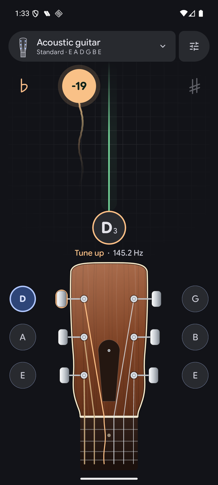
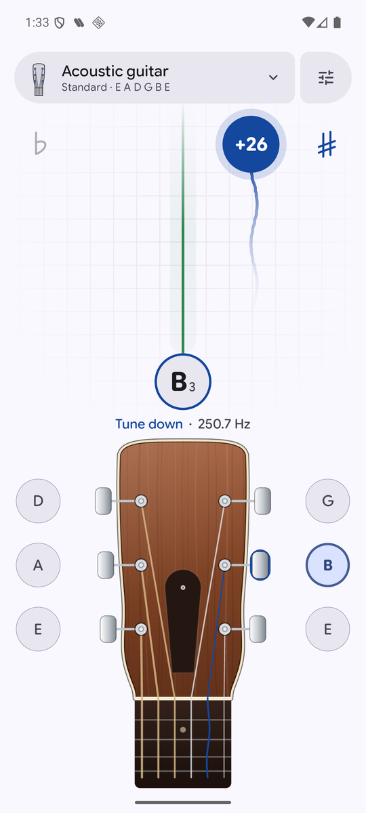
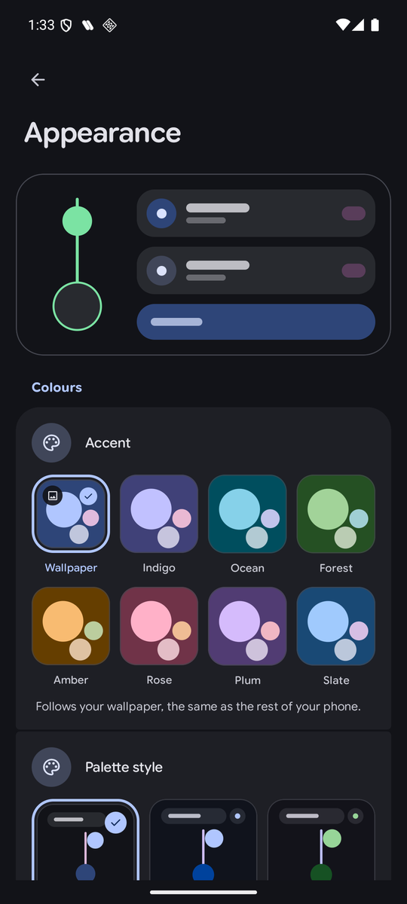

# GuitarTuner

[English](README.md) | Nederlands

**Een open source chromatische stemmer voor Android met een houten gitaarkop.** De kleuren volgen je achtergrond, hij stemt elf instrumenten en luistert naar je snaren zonder iets naar buiten te sturen. Geen reclame, geen account. De enige netwerkaanroep is een controle van de GitHub-releases, om te laten weten dat er een nieuwe versie is.

## Screenshots

  
  
  

## Wat het doet

- **Een lijn en een bel.** De bel schuift langs de lijn mee met de toonhoogte: links is te laag, rechts te hoog, en er verschijnt een streepje als de snaar klopt. Het spoor erachter laat zien waar de toon net was
- **Een houten kop voor elk instrument.** Elf instrumenten, elk met een eigen kop en een bel naast elke stemmechaniek. Tik op een snaar om die te stemmen, tik nog eens om terug te gaan naar auto, houd vast om de toon te horen
- **Begint in auto.** Speel een snaar en hij vindt zelf welke het is. Zijn alle snaren klaar, tik dan op de noot onder de lijn om opnieuw te beginnen
- **Referentietonen.** Tik op de noot om hem te horen en op het gehoor te stemmen
- **Jouw kleuren.** Material You-kleuren van je achtergrond, licht, donker of zuiver zwart, in het Engels of Nederlands
- **Privé.** Geluid verlaat je toestel nooit

## Installeren

1. Download `guitartuner.apk` van de [nieuwste release](https://github.com/Marukiee/GuitarTuner/releases/latest) op je telefoon.
2. Open het bestand. Android vraagt één keer of de app waarmee je het opent (je browser of bestanden-app) apps van onbekende bronnen mag installeren. Zet dat aan, ga terug en tik op Installeren.

Daarna heb je GitHub nooit meer nodig. De app laat weten als er een nieuwere versie is en linkt er rechtstreeks naartoe. Elke release is met dezelfde sleutel getekend, dus updates komen over de vorige versie heen en je hoeft nooit eerst te verwijderen.

Je hebt Android 8 of nieuwer nodig. Je kunt de repository ook in [Obtainium](https://obtainium.imranr.dev) zetten om updates daar te krijgen.

## Hoe het werkt

Het signaal wordt begrensd, een McLeod-toonhoogtedetector vindt de noot en een paar controles voorkomen dat hij een octaaf verspringt. De lange versie, met de redenering achter elke keuze, staat in [docs/HOW-IT-WORKS.md](docs/HOW-IT-WORKS.md) (Engels).

Bouwen kan met JDK 21 en de Android SDK: `./gradlew assembleDebug`. Meer in de [Engelse README](README.md#build).

## Licentie

AGPL-3.0, zie [LICENSE](LICENSE). Google Sans Flex zit erbij onder de SIL Open Font License ([LICENSE-GoogleSansFlex.txt](LICENSE-GoogleSansFlex.txt)). Gemaakt door Mark Maakt Media.
